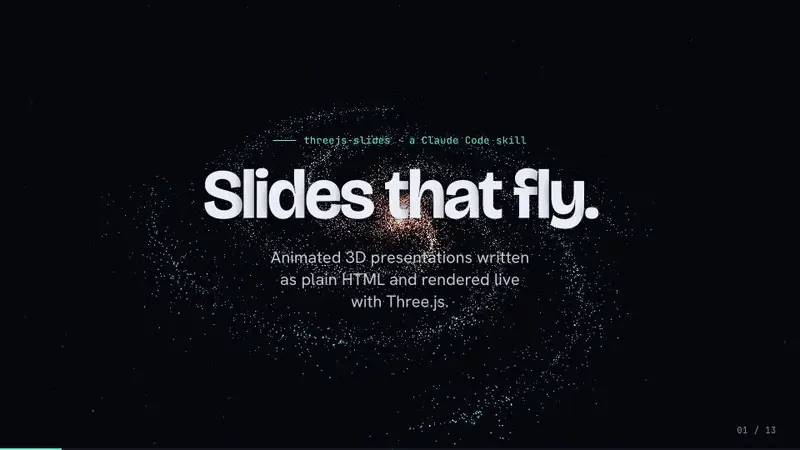
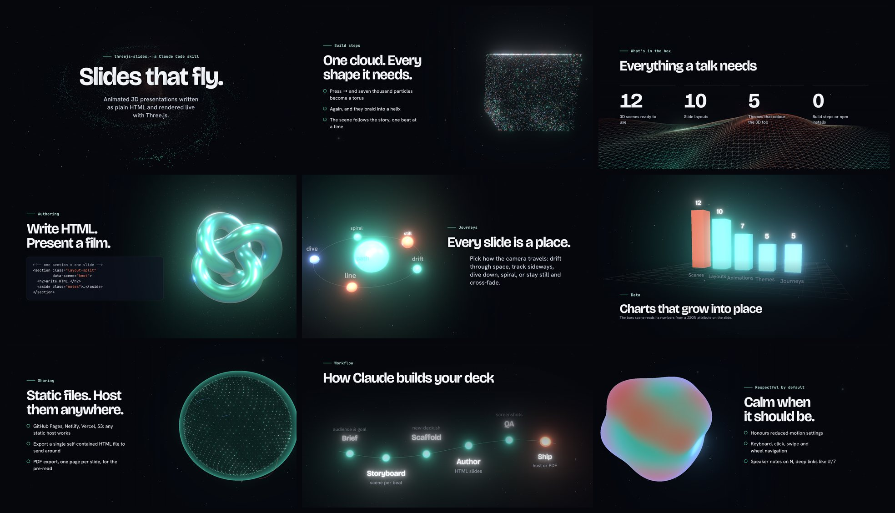

# threejs-slides

**A Claude Code skill for animated 3D presentations.** Ask Claude for a deck and get slides written as plain HTML, rendered live with [Three.js](https://threejs.org). The camera flies between slides through one 3D world, particle clouds morph on each click, globes draw their arcs and charts grow into place.

<p align="center">
  
</p>

<p align="center">
  <a href="https://parag08.github.io/threejs-slides/examples/demo/"><b>▶ Open the live demo deck</b></a>
  &nbsp;·&nbsp; <a href="#install">Install</a>
  &nbsp;·&nbsp; <a href="#usage">Usage</a>
  &nbsp;·&nbsp; <a href="skills/threejs-slides/references/scenes.md">Scene library</a>
</p>

---

## Install

### Option 1: Claude Code plugin (recommended)

Run these in Claude Code **as two separate messages**:

```text
/plugin marketplace add https://github.com/Parag08/threejs-slides
```

```text
/plugin install threejs-slides@threejs-slides
```

Restart Claude Code if it asks. The skill is then available as `/threejs-slides:threejs-slides`, and Claude also picks it up on its own when you ask for an animated or 3D presentation.

> Use the full HTTPS URL. The short `Parag08/threejs-slides` form can make Claude Code try SSH, which fails when GitHub isn't in your `known_hosts`.

**In the Claude desktop app** (or anywhere `/plugin` opens a dialog that doesn't let you finish), run the same two steps in a terminal instead:

```bash
claude plugin marketplace add https://github.com/Parag08/threejs-slides
```

```bash
claude plugin install threejs-slides@threejs-slides
```

Then start a new session: skills load when a session starts.

### Option 2: skills CLI

```bash
npx skills add Parag08/threejs-slides
```

### Option 3: manual

```bash
git clone https://github.com/Parag08/threejs-slides.git
mkdir -p ~/.claude/skills
cp -r threejs-slides/skills/threejs-slides ~/.claude/skills/
```

Use `.claude/skills/` inside a project instead of `~/.claude/skills/` to install it for that project only. Standalone skills aren't namespaced: invoke it with `/threejs-slides`.

### Optional: QA tooling

The skill takes screenshots of every slide to check its own work. That needs Playwright once:

```bash
cd ~/.claude/skills/threejs-slides/scripts && npm install && npx playwright install chromium
```

(For a plugin install the skill lives under `~/.claude/plugins/…/skills/threejs-slides/scripts`. Claude runs this for you the first time it needs it.)

**Requirements:** Node 18+ for the scripts, and Python 3 or any static server to preview. Decks run in any modern browser with WebGL.

## Usage

Just ask:

```text
Make an animated 3D deck for my 10-minute talk on how our search ranking works.
Audience: engineers. Dark, technical feel.
```

```text
/threejs-slides:threejs-slides turn notes.md into a pitch deck, ember theme, about 12 slides
```

```text
Convert this outline into a cinematic presentation with a globe for our market slide and a timeline for the roadmap.
```

Claude follows the skill's workflow:

1. **Brief**: purpose, audience, length, mood (asked in one go, or inferred).
2. **Storyboard**: a table of message → layout → 3D scene → motion beat for every slide.
3. **Scaffold**: `new-deck.sh` creates the folder with the runtime and theme fonts.
4. **Author**: one `<section>` per slide, with build steps and speaker notes.
5. **QA**: headless screenshots of every slide plus automatic checks for overflow, overlap, tiny text and console errors; Claude looks at each screenshot and fixes what's wrong.
6. **Deliver**: run it locally, export a single HTML file or a PDF, or host it anywhere static.

## What a slide looks like

```html
<section class="layout-split" data-scene="morph" data-params='{"shapes":["sphere","torus","helix"]}'>
  <span class="kicker">Build steps</span>
  <h2>One cloud. Every shape it needs.</h2>
  <ul class="points">
    <li data-step="1" data-anim="left">Press → and the cloud becomes a torus</li>
    <li data-step="2" data-anim="left">Again, and it braids into a helix</li>
  </ul>
  <aside class="notes">Speaker notes: press N.</aside>
</section>
```

No build step and no framework. Three.js loads from a CDN through an import map, and the deck is a folder of static files.

## What's in the box

<p align="center"></p>

| | |
|---|---|
| **17 scenes** | `galaxy` · `morph` · `globe` · `terrain` · `orbit` · `network` · `knot` · `blob` · `tunnel` · `cubes` · `timeline`, plus `registerScene()` for your own (glTF models, screenshots in 3D, anything) |
| **6 charts** | `bars` (grouped, stacked, 100%, horizontal, negatives, target line, delta bracket) · `line` (forecast + confidence band) · `waterfall` · `scatter` · `matrix` (2×2) · `gantt`, all sharing one chart kit: one-highlight colouring, step reveal, screen-reader tables |
| **5 camera journeys** | `drift` · `line` · `dive` · `spiral` · `still`: how the camera travels between slides |
| **13 layouts** | title, center, split, split-reverse, bottom, top, statement, section, stats, cards, plus the business formats summary, compare and table |
| **5 themes** | `nebula` · `ember` · `aurora` · `paper` · `mono`; the CSS variables colour the 3D too, and custom brand themes take a few lines |
| **Build steps** | `data-step` reveals text *and* drives the scene (morph to the next shape, highlight the next orbit item, advance the timeline) |
| **Presenter features** | **slide dots** (click to jump, title on hover; shown on the last slide and when the mouse nears the bottom), a **Fullscreen button** (top centre, shown on slide 1 and on top-edge hover), speaker notes (N), F for fullscreen, deep links (`#/7`), keyboard, click, swipe and wheel navigation, progress bar |
| **Respectful** | honours `prefers-reduced-motion`, a fixed 16:9 stage that scales without reflowing, deterministic scenes |
| **Export** | single self-contained HTML (`bundle.mjs`), PDF (`qa.mjs --pdf`), or any static host |

## Repository layout

Modelled on [anthropics/skills](https://github.com/anthropics/skills), [obra/superpowers](https://github.com/obra/superpowers) and [frontend-slides](https://github.com/zarazhangrui/frontend-slides): a short `SKILL.md` that loads detail from reference files only when it needs it, scripts for the deterministic parts, and plugin manifests so it installs in one command.

```
threejs-slides/
├── .claude-plugin/
│   ├── plugin.json            # plugin metadata
│   └── marketplace.json       # lets `/plugin marketplace add` find it
├── skills/threejs-slides/
│   ├── SKILL.md               # the workflow Claude follows
│   ├── references/
│   │   ├── scenes.md          # every scene: meaning, params, steps, pairing
│   │   ├── authoring.md       # layouts, attributes, animation, themes
│   │   ├── design.md          # storytelling and visual rules
│   │   └── custom-scenes.md   # registerScene API and recipes
│   ├── scripts/
│   │   ├── new-deck.sh        # scaffold a deck
│   │   ├── qa.mjs             # screenshots + layout checks + PDF
│   │   └── bundle.mjs         # single-file export
│   └── assets/
│       ├── runtime/           # threejs-slides.js · scenes.js · threejs-slides.css
│       └── template/          # starter index.html
├── examples/demo/             # the demo deck (built with this skill)
├── evals/                     # `claude plugin eval` suite + check-deck.mjs
└── docs/                      # README media
```

## Using the runtime without Claude

The runtime is a normal ES module, so you can write decks by hand:

```bash
bash skills/threejs-slides/scripts/new-deck.sh my-talk --theme ember --title "My talk"
python3 -m http.server 8000 --directory my-talk     # open http://localhost:8000
```

See [authoring.md](skills/threejs-slides/references/authoring.md) for the full reference.

## Run the demo locally

```bash
git clone https://github.com/Parag08/threejs-slides.git && cd threejs-slides
python3 -m http.server 8000      # open http://localhost:8000/examples/demo/
```

## Contributing

Issues and PRs are welcome, especially new scenes. A scene is one factory function (see [custom-scenes.md](skills/threejs-slides/references/custom-scenes.md)). To add one to the built-in library, put it in `assets/runtime/scenes.js`, document it in `references/scenes.md`, add a slide to the demo, and run `node skills/threejs-slides/scripts/qa.mjs examples/demo`. After changing the runtime, run `bash scripts/sync-runtime.sh` to update the demo's copy. Before and after changing `SKILL.md` or a reference, run the evals: `claude plugin eval . --tag activation --ablation none` is quick, and [evals/README.md](evals/README.md) covers the full-deck suite.

## License

MIT. Three.js is MIT-licensed and loaded from jsDelivr at runtime. Fonts come from Google Fonts under the SIL Open Font License.
